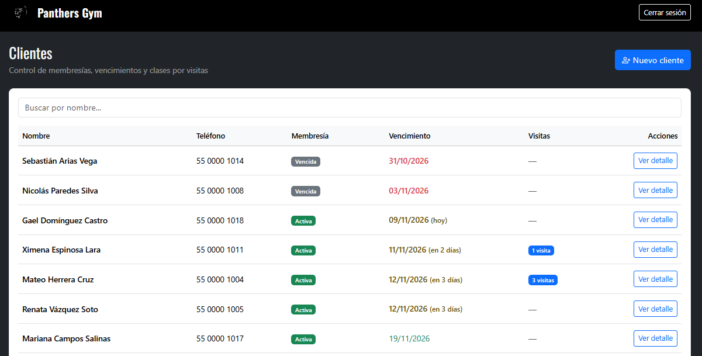
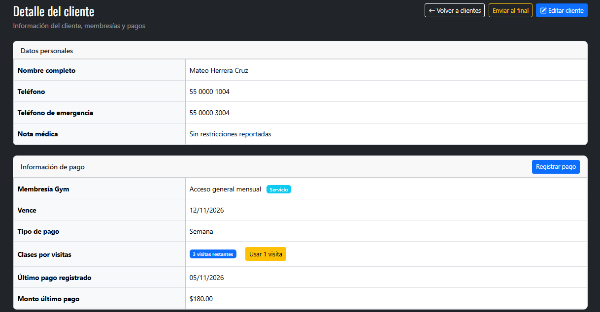
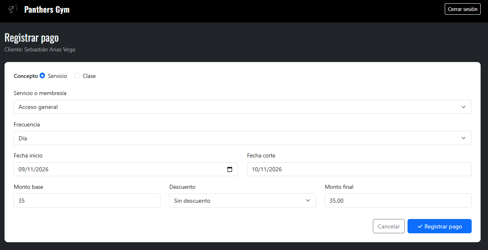
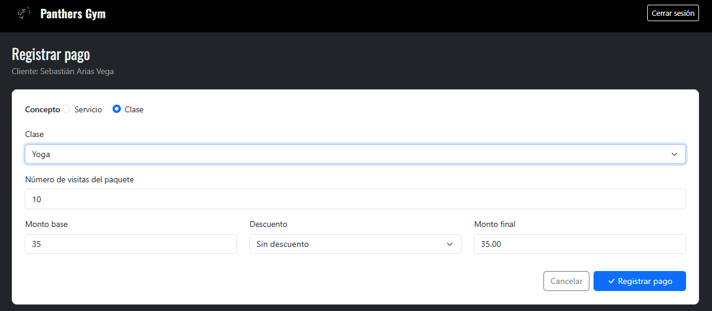
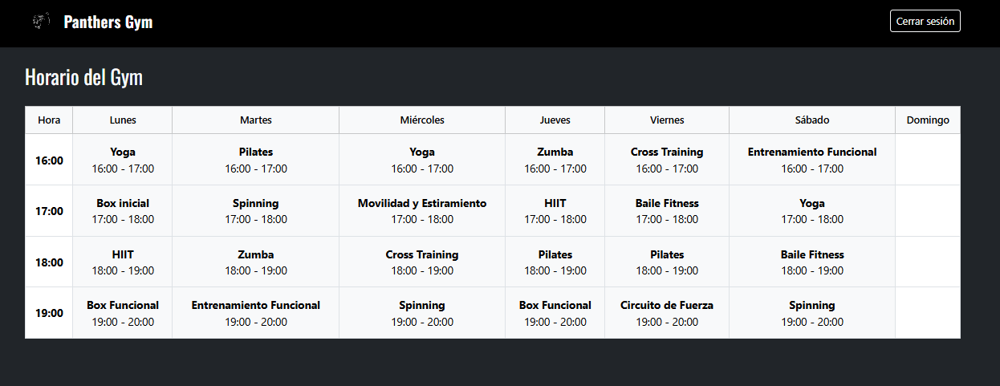
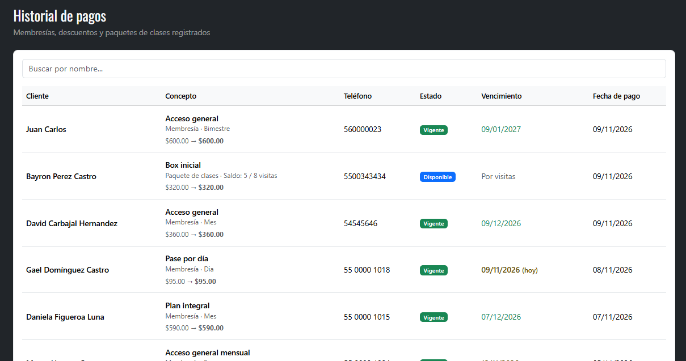
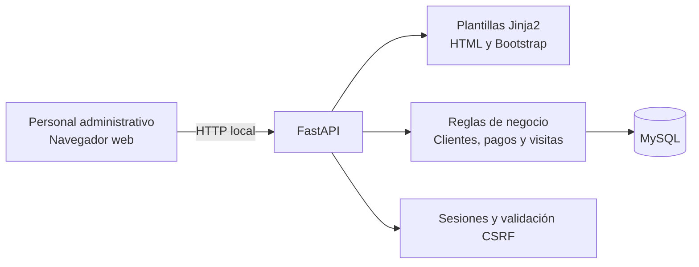

# GymControl

**Sistema web de administración para un gimnasio real, desarrollado con Python, FastAPI y MySQL.**

GymControl centraliza el registro de clientes, el seguimiento de membresías, los pagos, los descuentos y la organización de clases y horarios. Fue utilizado por personal administrativo de un gimnasio; actualmente el sistema original ya no está en operación debido a un cambio de administración.

Este repositorio conserva el código del proyecto y permite reproducirlo **localmente con una base de datos de demostración y registros ficticios**, sin utilizar información de los clientes reales.

## Funcionalidades

| Módulo | Funciones principales |
| --- | --- |
| **Clientes** | Registro, consulta y edición; búsqueda, paginación y organización según vencimiento de membresías. |
| **Membresías** | Control de vigencia y fechas de corte; pagos por día, semana, mes, bimestre, trimestre, cuatrimestre o año. |
| **Pagos y descuentos** | Registro de cobros, cálculo de importes con descuento y consulta del historial de pagos. |
| **Clases por visitas** | Venta de paquetes de visitas, consulta del saldo restante y descuento manual de visitas utilizadas. |
| **Clases y coaches** | Administración de clases, entrenadores y sus asignaciones. |
| **Horarios** | Registro y consulta de actividades mediante un calendario semanal. |
| **Servicios** | Administración de servicios disponibles y su estado. |
| **Acceso administrativo** | Inicio y cierre de sesión; contraseñas verificadas con bcrypt y protección CSRF en formularios. |

## Capturas

Pantallas de la versión de demostración con datos ficticios.

**Listado de clientes**



**Detalle de cliente y visitas disponibles**



**Registro de pago de servicio**



**Registro de pago por clases**



**Horarios de clases**



**Historial de pagos**



## Tecnologías

| Capa | Herramientas |
| --- | --- |
| Backend | **Python**, **FastAPI** |
| Base de datos | **MySQL** mediante `mysql-connector-python` |
| Interfaz web | **Jinja2**, **Bootstrap 5**, HTML, CSS y JavaScript |
| Sesiones y seguridad | **Starlette SessionMiddleware**, **passlib/bcrypt**, tokens CSRF |
| Pruebas | **unittest**, validaciones de plantillas y GitHub Actions |

La interfaz se genera principalmente en el servidor mediante plantillas Jinja2. **No se presenta este proyecto como una API REST pública ni como una aplicación React.**

## Arquitectura general



El diagrama representa la **instalación de demostración local**, no la infraestructura histórica completa del gimnasio.

## Contexto y despliegue

GymControl surgió como un proyecto independiente para atender necesidades administrativas de un gimnasio real. La aplicación tuvo una etapa de despliegue en **AWS EC2 y Amazon Aurora RDS**, seguida de una migración a **alojamiento local con acceso mediante Tailscale**.

La infraestructura original no forma parte de esta reproducción. El repositorio proporciona una configuración de **demostración local**; no debe interpretarse como un servicio actualmente disponible en Internet ni como un despliegue listo para producción.

## Instalación local — Windows y MySQL 8

Requisitos: **Python 3.11** (recomendado para reproducir el entorno), **MySQL 8.0+**, Git y, opcionalmente, MySQL Workbench. Los comandos siguientes utilizan **PowerShell**.

### 1. Obtener el proyecto e instalar dependencias

```powershell
git clone https://github.com/DavidLealC/GymControl-Portfolio.git
cd GymControl-Portfolio
py -3.11 -m venv .venv
.\.venv\Scripts\python.exe -m pip install -r requirements.txt
```

### 2. Crear la base de demostración

En **MySQL Workbench**, abre y ejecuta los siguientes archivos **en este orden**:

1. [`database/schema_demo.sql`](database/schema_demo.sql): crea la base `gymcontrol_demo` y sus diez tablas.
2. [`database/seed_demo.sql`](database/seed_demo.sql): agrega clientes, servicios, pagos y clases **ficticios**.
3. [`database/check_demo.sql`](database/check_demo.sql): realiza consultas de verificación.

Los scripts de creación están pensados para una **base nueva**: `schema_demo.sql` falla si ya existe `gymcontrol_demo`, y `seed_demo.sql` supone identificadores iniciales. No vuelvas a ejecutarlos sobre una base con información que quieras conservar.

**Nunca ejecutes estos scripts sobre la base real del gimnasio.** El archivo actual [`database/schema_demo.sql`](database/schema_demo.sql) sirve para crear la base de demostración desde cero. Es un esquema reconstruido, no una copia exacta y verificada de la base de producción histórica.

### 3. Configurar variables de entorno

```powershell
Copy-Item .env.example .env
py -3.11 -c "import secrets; print(secrets.token_hex(32))"
```

Edita el archivo `.env` local con los datos de **tu instancia de MySQL**:

```dotenv
DB_HOST=127.0.0.1
DB_PORT=3306
DB_USER=TU_USUARIO_MYSQL
DB_PASSWORD=TU_CONTRASENA_MYSQL
DB_NAME=gymcontrol_demo
SECRET_KEY=PEGA_AQUI_LA_CLAVE_ALEATORIA_GENERADA
SESSION_HTTPS_ONLY=false
```

La aplicación requiere que `SECRET_KEY` tenga **al menos 32 caracteres**. El valor `SESSION_HTTPS_ONLY=false` es únicamente para pruebas HTTP en `localhost`; con HTTPS debe establecerse en `true`. **No compartas ni subas tu `.env`.**

### 4. Crear un administrador de demostración

El conjunto inicial de datos **no incluye usuarios ni contraseñas predeterminadas**. Genera un hash bcrypt desde la carpeta del proyecto:

```powershell
.\.venv\Scripts\python.exe -c "from getpass import getpass; from app.security import hash_password; print(hash_password(getpass('Contraseña local de prueba: ')))"
```

En MySQL Workbench, sustituye el marcador por el **hash** obtenido, no por la contraseña en texto plano, y ejecuta **una sola vez**:

```sql
USE gymcontrol_demo;

INSERT INTO usuario_sistema (nombre, usuario, password, rol, activo)
VALUES ('Administrador Demo', 'admin_demo', 'PEGA_AQUI_EL_HASH_BCRYPT', 'admin', 1);
```

La aplicación comprueba el usuario activo y el hash bcrypt para permitir el inicio de sesión. El campo `rol` se almacena, pero **no equivale a un sistema completo de permisos por rol**.

### 5. Ejecutar la aplicación

```powershell
.\.venv\Scripts\python.exe -m uvicorn app.main:app --host 127.0.0.1 --port 8000
```

Abre **http://127.0.0.1:8000/login** e inicia sesión con `admin_demo` y la contraseña elegida. La aplicación se inicia únicamente en la interfaz local de tu equipo.

Para consultar el procedimiento detallado de MySQL y las limitaciones de los respaldos, visita [`database/README.md`](database/README.md).

## Pruebas

La carpeta [`tests/`](tests/) incluye comprobaciones de sintaxis de Python, compilación y renderizado de plantillas, contratos estáticos del esquema y protección CSRF. Para ejecutarlas localmente:

```powershell
.\.venv\Scripts\python.exe -m pip install httpx==0.28.1
.\.venv\Scripts\python.exe -m unittest discover -s tests -v
```

También se ejecutan mediante [GitHub Actions](.github/workflows/static-checks.yml). **Estas pruebas automatizadas no son pruebas de integración completas con MySQL**. La instalación de demostración y sus funcionalidades fueron probadas manualmente con datos ficticios.

## Estructura del repositorio

```text
GymControl-Portfolio/
├── app/
│   ├── routes/           # Clientes, pagos, servicios, coaches, clases y horarios
│   ├── templates/        # Vistas HTML renderizadas con Jinja2
│   ├── database.py       # Conexión a MySQL
│   ├── security.py       # Hash y verificación de contraseñas
│   ├── csrf.py           # Protección de formularios
│   └── main.py           # Aplicación FastAPI y routers
├── database/
│   ├── schema_demo.sql   # Estructura sin datos reales
│   ├── seed_demo.sql     # Registros ficticios iniciales
│   └── check_demo.sql    # Consultas de verificación
├── docs/                 # Capturas de la demostración
├── tests/                # Pruebas automatizadas
├── .env.example          # Configuración sin secretos
└── requirements.txt
```

## Alcance y limitaciones

- La aplicación se desarrolló para un caso real, pero **la instancia utilizada por el gimnasio ya no está operativa**.
- El repositorio está preparado para **demostración local**; no debe exponerse públicamente sin revisar TLS/HTTPS, permisos, configuraciones y controles de seguridad.
- Quedan pendientes pruebas de integración automatizadas con MySQL y una revisión de operaciones concurrentes sobre el saldo de visitas.
- La base de demostración reconstruye el esquema necesario para ejecutar la última versión; **no constituye una copia exacta y verificada del esquema de producción histórico**.
- **No se incluyen datos de clientes reales, respaldos operativos, contraseñas ni archivos `.env`.** Este repositorio público se creó a partir de una copia depurada con historial nuevo.

---

**Estado del proyecto:** versión histórica recuperada, con instalación de demostración local y mantenimiento orientado a documentación, seguridad y presentación profesional.